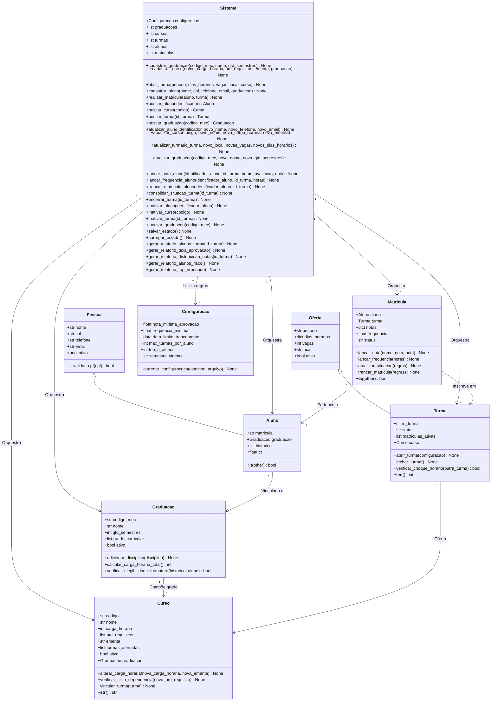

# Sistema Gerenciador de Cursos e Alunos (CLI / DDD)

## 1. Descrição e Objetivo

Este projeto consiste em um **Sistema de Gerenciamento Acadêmico Universitário** via Interface de Linha de Comando (CLI), desenvolvido em Python para aplicar de forma rigorosa os pilares de **Programação Orientada a Objetos (POO)**, **Domain-Driven Design (DDD)** e **Clean Code**.

O objetivo da aplicação é administrar todo o ciclo de vida acadêmico de uma instituição de ensino superior, abrangendo:
- Gestão do catálogo de **Graduações** e **Cursos (Disciplinas)** com prevenção contra ciclos de dependência entre pré-requisitos.
- Abertura, atualização e encerramento de **Turmas (Ofertas)** por semestre letivo.
- Cadastro de **Alunos** com validação matemática de dígitos verificadores de CPF, geração automática de matrícula no padrão institucional e cálculo ponderado do Coeficiente de Rendimento ($\text{CR} \ge 0$).
- Processamento de **Matrículas** com bateria de validações (pré-requisitos concluídos, detecção de choque de horário, limite de vagas e teto de disciplinas simultâneas).
- **Acompanhamento Acadêmico** completo com lançamento de avaliações (`AV1` e `AV2`), contabilização de frequência em horas-aula, trancamento dentro da data-limite e consolidação automática de aprovação ou reprovação.
- **Inativação Lógica (*Soft Delete*)** com travas de integridade referencial.
- **Relatórios Estatísticos e Gerenciais** utilizando a biblioteca nativa `statistics`.
- **Persistência em JSON** estruturada em camada de Repositórios com hidratação de chaves estrangeiras.

---

## 2. Arquitetura e Estrutura de Diretórios

O projeto está organizado segundo os princípios de separação de responsabilidades (DDD), isolando modelos de domínio, persistência, orquestração de serviços e interface de linha de comando:

```text
Gerenciador-de-Cursos-e-Alunos/
├── data/
│   ├── settings.json                # Parâmetros globais e regras de negócio
│   ├── graduacoes.json              # Persistência de graduações
│   ├── cursos.json                  # Persistência do catálogo de disciplinas
│   ├── turmas.json                  # Persistência de ofertas e metadados de IDs
│   ├── alunos.json                  # Persistência de alunos e metadados de matrículas
│   └── matriculas.json              # Persistência de vínculos, notas e frequência
├── src/
│   ├── config/
│   │   └── config.py                # Classe Configuracao (leitura e validação do settings.json)
│   ├── domain/
│   │   └── models/
│   │       ├── pessoas.py           # Superclasse Pessoa (validações de CPF, nome, e-mail, telefone)
│   │       ├── alunos.py            # Subclasse Aluno (matrícula, histórico, cálculo de CR e __lt__)
│   │       ├── ofertas.py           # Superclasse Oferta (período, horários, vagas e local)
│   │       ├── turmas.py            # Subclasse Turma (status, quórum e choque de horário)
│   │       ├── graduacoes.py        # Classe Graduacao (grade curricular e elegibilidade de colação)
│   │       ├── cursos.py            # Classe Curso (ementa, carga horária e ciclo de pré-requisitos)
│   │       └── matriculas.py        # Classe associativa Matricula (notas, frequência e trancamento)
│   ├── repositories/
│   │   ├── repositorio_graduacao.py # Serialização e hidratação de Graduacao
│   │   ├── repositorio_curso.py     # Serialização e Two-Pass Hydration de Curso
│   │   ├── repositorio_turma.py     # Serialização de Turma e estado do contador sequencial
│   │   ├── repositorio_aluno.py     # Serialização de Aluno e estado do contador de matrícula
│   │   └── repositorio_matricula.py # Serialização de vínculos, notas e horas frequentadas
│   └── services/
│       └── sistema.py               # Classe Sistema (Orquestrador / Padrão Facade)
├── tests/
│   └── test_sistema.py              # Suíte com 20 testes automatizados (pytest)
├── main.py                          # Ponto de entrada da CLI com subcomandos (argparse)
└── README.md                        # Documentação técnica do projeto
```

---

## 3. Diagrama UML Final

O diagrama abaixo representa a arquitetura completa das classes de domínio, configuração e orquestração do sistema:



---

## 4. Decisões de Design (Design Decisions)

1. **Arquitetura em Camadas (DDD Simplificado) e Padrão *Facade*:**
   - As entidades de domínio (`src/domain/models`) concentram exclusivamente regras intrínsecas ao negócio e validações de estado.
   - A camada de persistência (`src/repositories`) isola toda a manipulação de arquivos JSON, impedindo que o domínio conheça detalhes de armazenamento em disco.
   - A classe `Sistema` (`src/services/sistema.py`) implementa o padrão de projeto **Facade**, servindo como ponto único de comunicação para a interface de linha de comando (`main.py`).

2. **Encapsulamento Estrito e Blindagem de Dados (`@property`):**
   - Todos os atributos sensíveis são protegidos e expostos por meio de `@property`.
   - Atributos de identificação gerados automaticamente (`matricula` em `Aluno`, `codigo` em `Curso`, `id_turma` em `Turma`) e coleções históricas (`historico`, `grade_curricular`, `matriculas_ativas`) são *Read-Only* (não possuem `@setter`), prevenindo sobrescritas acidentais.
   - Validações rigorosas impedem estados inválidos: notas restritas ao intervalo $[0, 10]$, frequência percentual em $[0, 100]$, ementas com mínimo de $100$ caracteres e validação matemática real dos dois dígitos verificadores do CPF.

3. **Higienização e Padronização com Expressões Regulares (`re`):**
   - Textos como nomes de alunos, cursos e graduações passam por limpeza via Regex e capitalização inteligente (preservando preposições como *"de"*, *"da"*, *"do"*, *"para"* em minúsculas).
   - CPFs, códigos MEC e telefones são higienizados para armazenar apenas dígitos numéricos, garantindo integridade nas buscas.

4. **Prevenção de Importação Circular (*Forward Referencing*):**
   - Como há associações bidirecionais entre os modelos (ex: `Curso` referencia `Turma` e `Turma` referencia `Curso`), utilizou-se a constante `TYPE_CHECKING` do módulo `typing` combinada com *Forward References* em formato de string (ex: `curso: "Curso"`). Isso assegura *Type Hinting* completo na IDE sem causar erros de importação circular em tempo de execução.

5. **Hidratação em Duas Passagens (*Two-Pass Hydration*) e Metadados JSON:**
   - Na reconstrução dos objetos a partir do disco (`carregar_estado`), a ordem de leitura respeita a árvore de dependências (`Graduacao` $\rightarrow$ `Curso` $\rightarrow$ `Turma` $\rightarrow$ `Aluno` $\rightarrow$ `Matricula`).
   - O `RepositorioCurso` aplica *Two-Pass Hydration*: na primeira passagem instancia todos os cursos e vincula-os às graduações; na segunda passagem reconstrói a lista de objetos de pré-requisitos (`Curso` $\rightarrow$ `Curso`).
   - Os repositórios de `Aluno` e `Turma` armazenam um bloco `"metadados"` no JSON para preservar o estado dos contadores estáticos (`_contador_alunos` e `_contador_turma`) entre diferentes execuções da CLI.

6. **Exclusão Lógica (*Soft Delete*) e Travas de Integridade:**
   - Nenhum registro é destruído fisicamente da base de dados. Todas as entidades principais contam com a flag booleana `ativo = True`.
   - O `Sistema` impõe travas antes de inativar um registro: não é permitido inativar alunos com disciplinas `"Cursando"`, cursos com turmas `"Aberta"` ou graduações que ainda possuam cursos ativos.
   - Da mesma forma, em `atualizar_curso`, é permitido atualizar apenas a ementa de uma disciplina, mas a alteração de carga horária exige obrigatoriamente a atualização simultânea da ementa e a inexistência de turmas abertas.

7. **CLI Orientada a Subcomandos (`argparse`):**
   - Em conformidade com a especificação técnica, a interface foi construída com subcomandos independentes via `argparse`, permitindo automação direta pelo terminal e persistência automática ao término de cada operação.

---

## 5. Instruções de Instalação e Execução (CLI)

### Pré-requisitos do Ambiente
- **Python 3.10+** instalado.
- Biblioteca `pytest` para execução da bateria de testes automatizados:
  ```bash
  pip install pytest
  ```

### Configuração (`data/settings.json`)
O arquivo `data/settings.json` parametriza as regras globais da instituição (e é recriado automaticamente com valores padrão caso não exista):
```json
{
    "nota_minima_aprovacao": 7.0,
    "frequencia_minima": 75.0,
    "data_limite_trancamento": "2026-11-09",
    "max_turmas_por_aluno": 8,
    "top_n_alunos": 100,
    "semestre_vigente": "2026.2"
}
```

### Exemplos de Uso dos Subcomandos

Execute os comandos abaixo a partir da raiz do projeto:

#### 1. Popular o Sistema com Dados de Demonstração (`seed`)
Cria automaticamente uma graduação, disciplinas encadeadas por pré-requisito, turmas, alunos com CPFs válidos, matrículas e lançamentos iniciais:
```bash
python main.py seed
```

#### 2. Cadastros (`cadastrar-graduacao`, `cadastrar-curso`, `abrir-turma`, `cadastrar-aluno`)
```bash
# Cadastrar uma nova graduação
python main.py cadastrar-graduacao --codigo-mec 87654321 --nome "Ciência da Computação" --semestres 8

# Cadastrar um curso (disciplina)
python main.py cadastrar-curso --nome "Estrutura de Dados" --carga-horaria 60 --graduacao 12345678 --pre-requisitos ES0001 --ementa "Estudo detalhado de listas lineares, pilhas, filas, árvores binárias de busca, tabelas hash e algoritmos de ordenação."

# Abrir uma turma para um curso
python main.py abrir-turma --curso ES0001 --periodo 2026.2 --horarios "seg=14:00-16:00,qua=14:00-16:00" --vagas 30 --local "Bloco I - Sala 12"

# Cadastrar um aluno
python main.py cadastrar-aluno --nome "Gabriel Santos" --cpf 39053344705 --telefone 88999991111 --email gabriel.santos@ufca.edu.br --graduacao 12345678
```

#### 3. Matrícula e Acompanhamento Acadêmico
```bash
# Matricular aluno em uma turma aberta
python main.py matricular --aluno 39053344705 --turma 2026201

# Lançar notas (AV1 e AV2) e frequência (em horas-aula)
python main.py lancar-nota --aluno 39053344705 --turma 2026201 --avaliacao AV1 --nota 8.5
python main.py lancar-nota --aluno 39053344705 --turma 2026201 --avaliacao AV2 --nota 9.5
python main.py lancar-frequencia --aluno 39053344705 --turma 2026201 --horas 54

# Trancar matrícula de um aluno (dentro da data-limite)
python main.py trancar-matricula --aluno 39053344705 --turma 2026201

# Encerrar turma (consolida aprovações/reprovações e fecha a oferta; exige quórum mínimo de 5 alunos)
python main.py encerrar-turma --turma 2026201
```

#### 4. Consultas, Listagens, Atualizações e Inativações (*Soft Delete*)
```bash
# Listar registros ativos por categoria (graduacoes | cursos | turmas | alunos)
python main.py listar cursos
python main.py listar turmas
python main.py listar alunos

# Buscar um registro específico
python main.py buscar aluno 52998224725
python main.py buscar curso ES0001

# Atualização parcial (altera apenas os parâmetros informados)
python main.py atualizar-aluno --id 52998224725 --telefone 88988880000
python main.py atualizar-turma --turma 2026201 --local "Laboratório 04" --vagas 35

# Inativar logicamente um registro (aluno | curso | turma | graduacao)
python main.py inativar turma 2026202
```

#### 5. Geração de Relatórios Acadêmicos (`relatorio`)
```bash
# 1. Lista de alunos por turma e ocupação de vagas
python main.py relatorio alunos-turma --turma 2026201

# 2. Distribuição estatística de notas (Média, Mediana e Desvio Padrão)
python main.py relatorio distribuicao-notas --turma 2026201

# 3. Taxa de aprovação institucional e por graduação
python main.py relatorio taxa-aprovacao

# 4. Alerta de alunos em zona de risco (nota ou frequência abaixo do mínimo)
python main.py relatorio alunos-risco

# 5. Ranking Top N melhores alunos por período
python main.py relatorio top-n --periodo 2026.2
```

---

## 6. Testes Automatizados e Cobertura (`pytest`)

A suíte de testes localizada em `tests/test_sistema.py` utiliza as fixtures `tmp_path` e `monkeypatch` do `pytest` para criar um ambiente de execução 100% isolado em diretório temporário, garantindo que os arquivos reais da pasta `data/` nunca sejam modificados durante os testes.

### Como Executar os Testes
Na raiz do projeto, execute:
```bash
python -m pytest -v
```

### Matriz de Cobertura dos Casos de Teste ($20$ Cenários)

| ID     | Caso de Teste                                                   | Regra de Negócio / Requisito Validado                                                                       |
|:-------|:----------------------------------------------------------------|:------------------------------------------------------------------------------------------------------------|
| **01** | `test_01_cadastro_graduacao_curso_e_vinculo_grade`              | Cadastro de graduação e curso, geração de código automático, soma de carga horária e `__str__`.             |
| **02** | `test_02_impedir_ciclo_dependencia_pre_requisitos`              | Bloqueio de ciclo direto de dependência entre disciplinas ($A \leftrightarrow B$).                          |
| **03** | `test_03_validacao_cpf_invalido_e_duplicidade_aluno`            | Rejeição de CPFs matematicamente inválidos e bloqueio de CPF duplicado.                                     |
| **04** | `test_04_matricula_sucesso_e_vinculo_historico`                 | Matrícula regular e vínculo bidirecional em `turma.matriculas_ativas` e `aluno.historico`.                  |
| **05** | `test_05_matricula_negada_pre_requisito_nao_atendido`           | Matrícula negada quando o aluno não possui aprovação prévia no pré-requisito.                               |
| **06** | `test_06_matricula_permitida_apos_cumprir_pre_requisito`        | Liberação de matrícula na disciplina avançada após aprovação consolidada no pré-requisito.                  |
| **07** | `test_07_matricula_negada_choque_horario`                       | Detecção e bloqueio de choque de dias/horários entre turmas ativas do aluno.                                |
| **08** | `test_08_matricula_negada_turma_lotada`                         | Bloqueio de matrícula quando a ocupação atinge a capacidade máxima de vagas da turma.                       |
| **09** | `test_09_matricula_negada_turma_fechada`                        | Impedimento de matrícula em turmas com status `"Fechada"`.                                                  |
| **10** | `test_10_matricula_negada_limite_maximo_turmas_simultaneas`     | Bloqueio quando o aluno atinge o teto `max_turmas_por_aluno` parametrizado.                                 |
| **11** | `test_11_lancamento_notas_frequencia_e_aprovacao`               | Cálculo automático da Média Final (`MF`), percentual de presença e consolidação como `"Aprovado"`.          |
| **12** | `test_12_reprovacao_por_nota_e_por_frequencia`                  | Consolidação exata de `"Reprovado por Nota"`, `"Reprovado por Falta"` e `"Reprovado por Falta e por Nota"`. |
| **13** | `test_13_trancamento_matricula_dentro_e_fora_do_prazo`          | Liberação de vaga ao trancar dentro do prazo e bloqueio após `data_limite_trancamento`.                     |
| **14** | `test_14_calculo_cr_media_ponderada_e_ordenacao_lt`             | Cálculo do CR ponderado por carga horária e ordenação de alunos via método especial `__lt__`.               |
| **15** | `test_15_relatorio_alunos_turma_e_ocupacao`                     | Emissão do relatório de ocupação da turma e listagem de alunos inscritos.                                   |
| **16** | `test_16_relatorio_distribuicao_notas_e_taxa_aprovacao`         | Cálculo estatístico de média, mediana, desvio padrão e taxa de aprovação global/por curso.                  |
| **17** | `test_17_relatorio_alunos_risco_e_top_n_periodo`                | Identificação preventiva de alunos em zona de risco e geração do ranking Top N no semestre.                 |
| **18** | `test_18_atualizacao_parcial_crud_e_regra_carga_horaria_ementa` | Atualização parcial de dados e exigência de nova ementa ao alterar a carga horária do curso.                |
| **19** | `test_19_soft_delete_inativacoes_e_travas_seguranca`            | Travas de segurança contra órfãos e execução completa do *Soft Delete* (`ativo = False`).                   |
| **20** | `test_20_persistencia_json_salvar_e_carregar_estado`            | Serialização e reconstrução integral de objetos, pré-requisitos, notas e frequências via JSON.              |